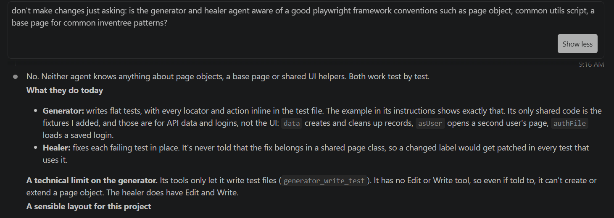
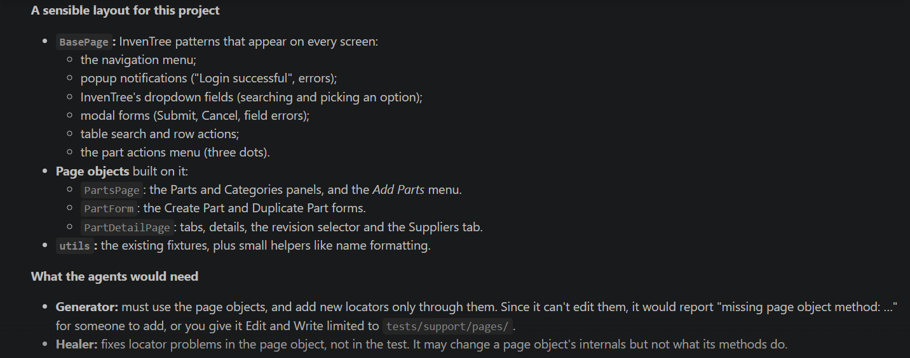
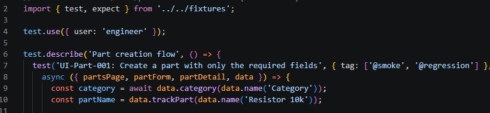
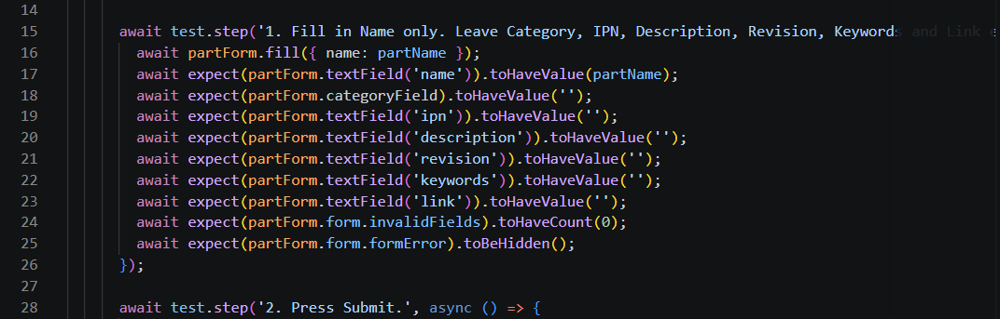

**Decision Log**

Decisions I took while directing the AI agents, the corrections I made to their output, how to run the agent workflows and the tests, and what generation cost.

# **1. Knowledge base and test case generation**

| **\#** | **Decision** | **Why / effect** | **Status** |
|----|----|----|----|
| 1 | RAG | The requirements are relatively small, But if in future it increases in size we will need something more scalable. | Done |
| 2 | Requirements index (requirements/INDEX.md) | Only the targeted content is added to context. Agent rule: "Look up requirements via requirements/INDEX.md, then read only the section you need", so every agent session uses the index by default. | Done |
| 3 | Rule sets split by area (functionality) | Saves around 70–80% of usage and makes test case creation faster. | Done |
| 4 | Fetch existing test cases before creating new ones | Planned for future runs. | To do |
| 5 | Duplicate check | *Add details* | To do |
| 6 | Review field on every test case | test-case-creator always writes "Draft" and never any other value. Once a person has reviewed the case, it is marked "Approved". | Done |
| 7 | Conflict handling | *Add details* | *Status* |

# **2. UI automation: corrections to the agent's output**

## **2.1 Framework conventions not followed**

The agents didn't initially follow the standards usually applied in an automation framework. The exchange below shows my question and the agent's recommendation.

*Figure 1. My question about framework conventions, and the start of the agent's answer.*

*Figure 2. The agent's recommended layout.*

That recommendation still mixed layers and wouldn't suit the framework once the automation scales, so I sent this prompt:

> *Yes we need to make a conventions.md- create a draft and I will review. Lets implement above standards in these layer-*
>
> *1. Test Layer - Contains actual test scripts (\*.spec.ts or \*.spec.js). These files should contain minimal logic and read like business requirements, focusing primarily on the workflow execution and assertions.*
>
> *2. Page Object Model Layer (pages/): Encapsulates the UI elements (locators) and behavior (actions like clicking, typing, or navigating) for individual pages. Tests interact with these classes rather than querying raw DOM elements directly,*
>
> *3. Fixtures Layer (fixtures/): Manages shared setup and teardown logic, browser contexts, and authenticated states (storageState). Custom fixtures inject page objects or API states directly into tests, cutting out repetitive boilerplate code.*
>
> *4. Utility Layer (utils/): Contains stateless helper functions such as custom date formatters, database clients, custom loggers, or string generators.*
>
> *5. Data & Configuration Layer (data/ & config/): Decouples environment-specific URLs, timeouts, secret variables, and test input matrices (JSON/CSV files) from the executable code (I think playwright.config.ts is the right file for this purpose). Lets make a plan to implcment these so that I can review before implementing*

**Outcome:** conventions.md now documents these layers in full.

## **2.2 Incomplete validation of form fields**

**What the agent did:** After filling the part name, category and IPN, the generated scripts verified only the input boxes, not the dropdown. If a part wasn't created because of a missing detail, the failure would be hard to explain.

**What I changed:** Updated the script, and added an instruction for the agent to verify every filled value.

## **2.3 Saved logins instead of a real login**

**What the agent did:** Built a shortcut that saved the CSRF token and session cookie and injected them whenever a login was needed. Every spec file triggered it with the step below (line 4).

*Figure 3. A generated spec using the saved login (line 4).*

**Why I changed it:** It speeds up login, but it doesn't test the way a real user logs in.

**What I changed:** Reverted it, and updated the agent to generate tests that use the normal login.

## **2.4 Unnecessary complexity in configuration**

**What the agent did:** Created separate config files for the UI and API tests.

**What I changed:** Kept the configuration in one place, so a person can maintain it as well as the agents.

## **2.5 No environment handling**

**What the agent did:** Generated tests with no environment handling.

**What I changed:** Added a env file so that environment becomes a parameter to test.

## **2.6 No parametrization in API test cases**

**What the agent did:** Generated tests with no parametrization handling.Just kept adding new test cases for each new input.

**What I changed:** Added instructions to handle the parametrization in the test cases generator agent so that same test case runs and validates different expected outcomes against different values.

## **2.6 Added redundant assertions:**

**What the agent did:** Added assertions for the fields that were not added, see below line 18 to 25, also there is a asserton to check the invisibility of a field, this leads to flaky tests. 

**What I changed:** improvise that to keep low noise and put assertions for modified fields and the fields that are expected to be modified or asserted. And also not assert the invisibility of an element.

## 

# **3. Running the agent workflows**

Each stage is started by a single skill. Examples:

- Generate UI test cases: /gen-test-cases UI Part category hierarchy and filtering

- Generate API test cases: /gen-test-cases API Part and category CRUD

- Automate and review API test cases: /automate-api-cases API-CRUD-002 API-CRUD-003 API-CRUD-008 API-CRUD-011 API-CRUD-016 API-CRUD-017

| **Stage** | **Skill (one trigger)** | **Agents it runs, in order** | **Human step afterwards** |
|----|----|----|----|
| Manual test cases (UI or API) | /gen-test-cases | test-case-creator (Sonnet), then duplicate-judge (Opus) for borderline matches | Architect answers open questions and sets each case's Review field to Approved |
| UI automation | /automate-cases | playwright-test-generator (Sonnet), lint and type check, playwright-test-healer (Sonnet), 3-run stability check, playwright-test-reviewer (Opus) | Architect reads the review in automation/ui/reviews/ |
| API automation | /automate-api-cases | api-test-generator (Sonnet: writes, runs and stabilises), lint and type check, 3-run stability check, api-test-reviewer (Opus) | Architect reads the review in automation/api/reviews/ |

# **4. Running the tests**

| **What** | **Command** |
|----|----|
| All API tests (token setup runs first) | npm test |
| Only @smoke tests | npm run test:smoke |
| One spec | npx playwright test tests/CRUD/api-crud-001.spec.ts --project=api |
| A whole area | npx playwright test tests/CRUD --project=api |
| One case by ID | npx playwright test --project=api -g "API-CRUD-002" |
| Stability check (3 runs) | npx playwright test tests/CRUD/api-crud-001.spec.ts --project=api --repeat-each=3 |
| Open the HTML report | npm run report |

# **5. AI usage and cost**

## **5.1 UI automation generation**

With Sonnet 5.5, generating these tests cost about 10 cents per test case, or about \$0.68 for all six runs.

| **Case**                       |  **Tokens** | **Sonnet 5.5 cost** |
|--------------------------------|------------:|--------------------:|
| UI-Part-001                    |      42,798 |              \$0.12 |
| UI-Part-002                    |      27,331 |              \$0.08 |
| UI-Part-003                    |      28,109 |              \$0.08 |
| UI-Part-004                    |      43,090 |              \$0.12 |
| UI-Part-005                    |      33,076 |              \$0.09 |
| UI-Part-006 (stopped, no spec) |      68,676 |              \$0.19 |
| **Total**                      | **243,080** |        **≈ \$0.68** |

## **5.2 Bulk scenario test cases generation: 150+ API tests**

The subagents used about 1.21 million tokens in total: 370,967 in an earlier report plus 838,488 in the runs below. The three API functionalities took 752,652 of that.

| **Run** | **Tokens** | **Tool calls** | **Time** |
|----|---:|---:|---:|
| Part_Params: creator | 85,836 | 19 | 8.5 min |
| FIELD_Validation: creator | 101,474 | 20 | 6.8 min |
| FIELD_Validation: reviewer | 161,674 | 100 | 11.9 min |
| Lists_and_Filters: creator | 83,712 | 15 | 3.7 min |
| Lists_and_Filters: reviewer | 169,461 | 93 | 10.7 min |
| Relationships: creator | 112,351 | 36 | 5.8 min |
| Relationships: reviewer | 123,980 | 62 | 7.2 min |
| **Total since the earlier report** | **838,488** | **345** | **about 55 min** |

The reviewers cost more than the creators because they read every case in full. The totals leave out two interrupted runs (the Categories creator and the Part_Params reviewer) and the main session.

**Estimated cost:** about \$4–5.
