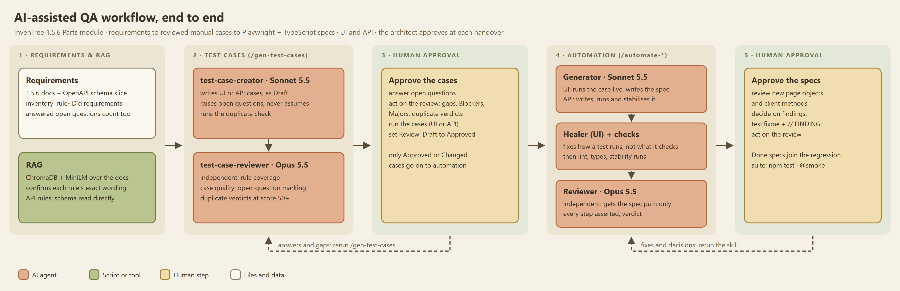

# AI-assisted QA of the InvenTree Parts module

EPAM Quality Architect assignment. Manual UI and API test cases generated from the InvenTree documentation and OpenAPI schema, then Playwright + TypeScript automation for both suites. AI agents do the writing; I act as the architect who directs them, reviews their output and approves it.

**Application under test:** InvenTree **1.5.6** (API version 530), Parts module only, running locally in Docker with the demo dataset.



---

## Contents

1. [What is delivered, and where](#what-is-delivered-and-where)
2. [Setup](#setup)
3. [Running the tests](#running-the-tests)
4. [Tool choices](#tool-choices)
5. [Skill prompts: all options](#skill-prompts-all-options)
6. [Approach](#approach)
7. [Results so far](#results-so-far)
8. [Known limits](#known-limits)

---

## What is delivered, and where

| Brief deliverable | Location | Notes |
|---|---|---|
| UI manual test cases | [`test-cases/`](test-cases/) (UI Area folders) | 660 cases in 10 Area folders, Markdown. Format: [`references/seed-manual-test-case.md`](references/seed-manual-test-case.md). |
| API manual test cases | [`test-cases/API_*`](test-cases/) | 259 cases in 5 Area folders (the field-validation cases are data-driven: one case, several data rows). Format: [`references/seed-api-test-case.md`](references/seed-api-test-case.md). |
| UI automation scripts | [`automation/tests/ui/`](automation/tests/ui/), [`automation/pages/`](automation/pages/) | Playwright + TypeScript, page objects. |
| API automation scripts | [`automation/tests/api/`](automation/tests/api/), [`automation/clients/`](automation/clients/) | Playwright API testing, Ajv schema checks against the OpenAPI slice. |
| Agent prompts | [`agents/prompts.md`](agents/prompts.md) | The prompts that show how I directed the agents (96 of 337, grouped by theme), every skill command, and how each agent is briefed. Exported from the session transcripts by [`tools/export_prompts.py`](tools/export_prompts.py); the selection is [`tools/prompts_selection.json`](tools/prompts_selection.json), and `--all` writes the full log. |
| System instructions | [`agents/system-instructions.md`](agents/system-instructions.md) | How the instructions are layered, every agent's role, model, tools and guardrails, the skills, and how the instructions changed. |
| Agent configs | [`CLAUDE.md`](CLAUDE.md), [`.claude/agents/`](.claude/agents/), [`.claude/skills/`](.claude/skills/), [`.mcp.json`](.mcp.json) | Submission copies in [`agents/configs/`](agents/configs/). How to trigger each one: [`agents/RUNNING.md`](agents/RUNNING.md). |
| Agent configuration | [`CLAUDE.md`](CLAUDE.md) (project instructions), [`.mcp.json`](.mcp.json) (Playwright MCP servers), [`automation/CONVENTIONS.md`](automation/CONVENTIONS.md) (framework rules the agents follow) | |
| Evidence of review | [`test-cases/Reviews/`](test-cases/Reviews/), [`automation/reviews/`](automation/reviews/), [`agents/reviewer-catches.md`](agents/reviewer-catches.md) | Every agent output is reviewed by a second, independent agent. |
| Findings | [`test-cases/findings.md`](test-cases/findings.md) | Mismatches between docs, schema and the running app (14 so far). |
| Video | [`videoLinks/video-links.md`](videoLinks/video-links.md) (Google Drive folder) | The recordings are over GitHub's 100 MB limit, so they are not in the repository. |

**One automation project instead of two.** The brief's layout shows `automation/ui/` and `automation/api/`. I used one Playwright project with two suites (`tests/ui`, `tests/api`) because they share the environment config, users, test-data fixtures and lint rules. Each suite still runs on its own (`npm run test:ui`, `npm run test:api`).

---

## Setup

### 1. InvenTree 1.5.6 in Docker

The version is pinned: the docs snapshot and the schema slice in this repository are both from 1.5.6.

```powershell
git clone --branch 1.5.6 https://github.com/inventree/InvenTree.git
cd InvenTree/contrib/container
# in .env: INVENTREE_TAG=1.5.6
docker compose up -d
docker compose run --rm inventree-server invoke dev.setup-test -i   # load the demo dataset and its users
```

The UI is then at `http://localhost/web`, the API at `http://localhost/api/`. The tests use the demo users (`admin`, `allaccess`, `engineer`, `reader`, `noaccess`, `steven`); their roles are listed in [`automation/data/users.local.json`](automation/data/users.local.json).

To reset to a clean dataset: `docker compose run --rm inventree-server invoke dev.setup-test -i`.

### 2. Automation project

Needs a current Node.js LTS.

```powershell
cd automation
npm ci
npx playwright install chromium
```

The address, timeouts and users come only from [`automation/config/env.ts`](automation/config/env.ts), which reads [`config/environments/local.json`](automation/config/environments/local.json). For the local demo instance nothing else is needed: it uses the demo dataset's published passwords. For any other instance, copy [`config/.env.example`](automation/config/.env.example) to `config/.env.<env>` (gitignored), fill in the passwords and run with `$env:TEST_ENV='<env>'`.

### 3. Agent tooling (only to rerun the agents)

- [Claude Code](https://claude.com/claude-code) (CLI or VS Code extension), opened at the repository root. It picks up `CLAUDE.md`, the agents, the skills and the MCP servers in `.mcp.json`.
- Python 3 for the tools in `tools/`. The RAG index needs its own venv: `tools/rag/requirements.txt`, then `tools/rag/.venv/Scripts/python.exe tools/rag/build_index.py`.

---

## Running the tests

From `automation/`:

| Task | Command |
|---|---|
| Both suites | `npm test` |
| UI suite | `npm run test:ui` |
| API suite | `npm run test:api` |
| Smoke tests only | `npm run test:smoke` |
| One spec | `npx playwright test tests/ui/XF/ui-xf-001.spec.ts --project=chromium` |
| Watch it in a browser | add `--headed` |
| Stability check | add `--repeat-each=3` |
| HTML report | `npm run report` |
| Lint and types | `npm run lint`, `npm run typecheck` |

Each UI test logs in as its own user through the real login form when it starts; there is no separate login step for all users. Tests run serially: some change global InvenTree settings, and parallel category deletes deadlock InvenTree's tree rebuild.

---

## Tool choices

| Need | Choice | Why |
|---|---|---|
| AI agent | **Claude Code** with project instructions, subagents and skills | Subagents give each job its own instructions, tools and model; skills chain them into one repeatable command. Everything is a Markdown file in the repository, so the workflow can be reviewed and rerun. |
| Models | **Sonnet 5.5** writes, **Opus 5.5** reviews | Writers do volume; reviewers need judgement. A reviewer on a stronger model, given only IDs or paths and never the writer's reasoning, catches what the writer cannot see in its own work ([`agents/reviewer-catches.md`](agents/reviewer-catches.md)). |
| Requirements source | Docs **snapshot pinned to 1.5.6** in [`requirements/docs/`](requirements/docs/), plus the Parts slice of the 1.5.6 OpenAPI schema ([`requirements/openapi-parts.yaml`](requirements/openapi-parts.yaml)) | The live docs track the latest release; testing 1.5.6 against them would produce false findings. |
| Requirement lookup | Local **RAG** index (ChromaDB + `all-MiniLM-L6-v2`) over the docs | The case writer confirms each rule's exact wording from the source instead of from memory, at a fraction of the tokens of reading whole pages. |
| UI and API automation | **Playwright + TypeScript**, one project | One runner, one language and one report for both suites; auto-waiting locators; built-in API client; traces on failure. |
| Live app access for agents | **Playwright MCP** servers ([`.mcp.json`](.mcp.json)) | The UI generator runs each case step in the real app before writing the spec, so locators come from the live accessibility tree, not guesses. |
| Schema checks | **Ajv** against `openapi-parts.yaml` | Every API response is validated against the published contract; mismatches become findings (F-06 to F-12). |
| Quality gates | ESLint (`eslint-plugin-playwright`), `tsc`, repeat runs | Lint bans the usual flaky patterns (`waitForTimeout`, `networkidle`, `force: true`, raw locators in specs). |
| Housekeeping scripts | Python in [`tools/`](tools/) | Duplicate detection, rule coverage, schema slicing: checks that should be exact, not left to a model. |

---

## Skill prompts: all options

Three skills run the workflow. All three are set `disable-model-invocation: true`, so they start only from a slash command (or the headless and fallback forms below), never from a plain-language request. Full detail: [`agents/RUNNING.md`](agents/RUNNING.md).

| Skill | Prompt form | Example | What runs | Notes |
|---|---|---|---|---|
| `/gen-test-cases` | `/gen-test-cases UI <functionality>` | `/gen-test-cases UI Part category hierarchy and filtering` | `test-case-creator` → `test-case-reviewer` | First word must be `UI` or `API`, then the functionality. Missing either: the skill asks and stops. |
| `/gen-test-cases` | `/gen-test-cases API <functionality>` | `/gen-test-cases API Category field validation on create and update` | `test-case-creator` → `test-case-reviewer` | Output: cases in the Area folder, questions in `Open_Questions/`, review in `Reviews/`. All cases are `Draft`. |
| `/gen-test-cases` | with an exclusion | `/gen-test-cases API Part field validation on create and update, except the part name on create (covered by API-VAL-001 to 004)` | same | The creator writes no case that existing ones already cover. |
| `/automate-cases` | one UI case ID | `/automate-cases UI-Part-002` | `playwright-test-generator` → lint and types → one run → `playwright-test-healer` (only if it fails) → `playwright-test-reviewer` (background) | Only `Approved` or `Changed` cases with no open questions. |
| `/automate-cases` | several UI case IDs | `/automate-cases UI-REV-001 UI-REV-002` | same, one case at a time | API IDs are skipped, with a pointer to `/automate-api-cases`. |
| `/automate-api-cases` | one API case ID | `/automate-api-cases API-CRUD-001` | `api-test-generator` → lint and types → 3-run check → `api-test-reviewer` | A case with a Data sets table becomes one spec with one test per row. |
| `/automate-api-cases` | several API case IDs | `/automate-api-cases API-CRUD-001 API-CRUD-008` | same, one case at a time | UI IDs are skipped, with a pointer to `/automate-cases`. |
| Any skill | headless CLI | `claude -p "/automate-api-cases API-CRUD-001" --permission-mode acceptEdits --allowedTools "Bash(npx playwright test *),Bash(npm run *),Bash(npx eslint *),Bash(python tools/dedupe_cases.py *)"` | same as the slash form | For scripts and CI. Grant only the commands the agents need; never `bypassPermissions`, never `--bare`. |
| Any skill | fallback, no skill mechanism | `Read .claude/skills/automate-api-cases/SKILL.md and follow it for: API-CRUD-001` | Claude follows the skill file by hand | Use only when the slash command and headless forms are not possible. |

Single agents can also be called on their own (plain language, `@`-mention, or `claude --agent <name>`):

| Agent | Example request |
|---|---|
| `test-case-creator` | `Generate API test cases for Part and category CRUD.` |
| `test-case-reviewer` | `Review API test cases for Part and category CRUD: API-CRUD-001, API-CRUD-002.` |
| `playwright-test-generator` | `Automate test case UI-REV-001.` |
| `playwright-test-healer` | `Run and stabilise automation/tests/ui/Part/ui-part-002.spec.ts` |
| `playwright-test-reviewer` | `Review automation/tests/ui/Part/ui-part-006.spec.ts` |
| `api-test-generator` | `Automate test case API-CRUD-001.` |
| `api-test-reviewer` | `Review automation/tests/api/CRUD/api-crud-001.spec.ts` |

---

## Approach

### The workflow

| Stage | Command | Agents (in order) | My step afterwards |
|---|---|---|---|
| Requirements | (done once, by agents, from a full read of the docs) | | Review the inventories: rule-ID'd requirements per Area, e.g. [`test-cases/Categories/requirements-inventory.md`](test-cases/Categories/requirements-inventory.md) |
| Manual cases | `/gen-test-cases <UI\|API> <functionality>` | `test-case-creator` → `test-case-reviewer` | Answer open questions, act on the review, run the case, set **Review: Approved** |
| UI automation | `/automate-cases <case IDs>` | `playwright-test-generator` → lint and types → one run (`playwright-test-healer` only if it fails) → `playwright-test-reviewer` | Read the review, decide on findings |
| API automation | `/automate-api-cases <case IDs>` | `api-test-generator` (writes, runs, stabilises) → 3-run check → `api-test-reviewer` | Read the review, decide on findings |

Diagrams: [test case generation](agents/diagrams/test-case-generation.png), [automation generation](agents/diagrams/automation-generation.png). Every way to trigger a skill or agent: [`agents/RUNNING.md`](agents/RUNNING.md).

### Rules the agents work under

From [`CLAUDE.md`](CLAUDE.md) and the agent files:

- **Never assume a requirement.** Anything the docs and schema do not state becomes an open question in [`test-cases/Open_Questions/`](test-cases/Open_Questions/) (`open-question_<Area>.md`). The case is still written, marked `Draft · Open question: Q-<Area>-NN`, and stays unapproved until I answer it.
- **Every case cites a rule.** Each case links its rule ID (`R-<Area>-NN`) and the exact doc or schema line. `tools/coverage_check.py` shows which rules have no case.
- **The architect owns approval.** Agents write `Draft`; only I set Approved, Changed or Rejected, answer questions or edit the inventories. Only Approved or Changed cases are automated.
- **A mismatch is a finding, not a fix.** When the app differs from an approved case, the test is marked `test.fixme()` with a `// FINDING:` comment and recorded in [`findings.md`](test-cases/findings.md). No agent may weaken an assertion to make a test pass.
- **Reviewers stay independent.** They receive case IDs or file paths only, never the writer's report.
- **No hard-coded hosts or credentials** outside `automation/config/` and `automation/data/`. UI tests always log in through the real login form.

### Test case design

- **Areas follow the brief.** Part creation and import, detail view tabs, categories, attributes, units of measure, revisions, parameters, templates and variants, plus [cross-functional scenarios](test-cases/Cross_Functional_Scenarios/) that chain several Areas on one record. API Areas: CRUD, lists and filters, field validation, relationships, security and permissions.
- **Techniques are named on every case:** equivalence partitioning, boundary value analysis, state transition, decision table, error guessing, negative, what-if business scenario.
- **Duplicates are checked by script** (`tools/dedupe_cases.py`); cases scoring 50 or more get a verdict (Keep, Merge, Remove, Escalate) from the reviewer.
- **Gaps between the brief and the docs are made explicit.** The brief names duplicate IPN, revision-of-revision prevention and a *Revisions* tab; the 1.5.6 docs state none of them ([inventory "Not in docs"](test-cases/requirements-inventory.md)). They were written as cases with open questions and then checked against the app: duplicate IPN is UI-Part-058 and API-VAL-074 to 077 (the `PART_ALLOW_DUPLICATE_IPN` setting, F-05), revision-of-revision is UI-REV-017.

### Automation design

Rules: [`automation/CONVENTIONS.md`](automation/CONVENTIONS.md).

- **Layered:** specs read like the manual case, one `test.step` per case step; locators live only in page objects (`pages/`) and shared components; API calls live in typed clients (`clients/`).
- **Robust waits and selectors:** role- and label-based locators taken from the live accessibility tree, web-first `expect` assertions, no fixed sleeps (lint-enforced).
- **Test data:** created through the API by fixtures with a unique `QA-<suffix>` prefix, and cleaned up after each test.
- **API assertions:** status code, response schema (Ajv against the OpenAPI slice) and business rules on every request.

### Human corrections

The brief asks what I changed in the agents' output and why. The records:

- **Test cases:** an Approved case's Review field notes what I changed in the agent draft, when I changed something; a Changed case always does. The reviewers' Blockers and Majors, and how each was resolved, are in [`agents/reviewer-catches.md`](agents/reviewer-catches.md).
- **Findings that changed cases:** [`test-cases/findings.md`](test-cases/findings.md). For example, F-14 records a case defect: a case assumed the `engineer` user could create stock; the live run showed it cannot, and I changed the case to `allaccess`.
- **Automation:** the independent reviews in [`automation/reviews/`](automation/reviews/).
- **The agents themselves:** when an agent kept making the same mistake, I changed its instructions rather than its output. Example: the UI generator wasted tool calls on a wrong seed path, relative URLs and full-page snapshots; its file now gives the exact arguments for each tool.

---

## Results so far

| | Total | Approved or Changed | Automated |
|---|---|---|---|
| UI cases | 660 | 30 | 7 specs: UI-Part-002 to 006 and UI-Part-074 (part creation), UI-XF-001 (cross-functional) |
| API cases | 259 | 27 | 9 specs: API-CRUD-001, 003, 007, 009, 010, 011, 012, 014; API-VAL-087 (data-driven, one test per row) |

- **Requirements:** 227 UI rules and 71 API rules in the inventories, plus 7 cross-functional flows composed from them.
- **Latest API cases (all `Draft`):** part name validation on create (API-VAL-087 to 091), part field validation on create and update (API-VAL-092 to 108), category field validation (API-VAL-109 to 123), duplicate and uniqueness conflicts (API-VAL-124 to 135, API-SEC-051).
- **Open questions:** about 215 raised by the agents across the Areas ([`test-cases/Open_Questions/`](test-cases/Open_Questions/)); a minority answered from live runs, the rest waiting for review.
- **Findings:** 14 in [`findings.md`](test-cases/findings.md), including 7 places where the 1.5.6 API breaks its own published schema (F-06 to F-12).
- **Reviews:** 29 test-case reviews in [`test-cases/Reviews/`](test-cases/Reviews/) and 22 automation reviews in [`automation/reviews/`](automation/reviews/).

**The cross-functional flow the brief asks for** is UI-XF-001 ([case](test-cases/Cross_Functional_Scenarios/cross-functional-scenarios.md), [spec](automation/tests/ui/XF/ui-xf-001.spec.ts)): create a part → add a parameter → create stock → check the stock level in the category list and the parameter value in the category's parametric view.

---

## Known limits

- **Automation covers the start of each suite, not all of it.** UI automation covers part creation and the cross-functional flow; part read, edit and delete through the UI are not yet automated. API automation covers CRUD and part name validation on create; lists and filters, the rest of validation, relationships and security have manual cases, not yet approved, and no specs.
- **Parameterised API tests:** API-VAL-087 runs one test per data row; the other data-driven validation cases are not yet automated.
- **Most cases are still Draft.** They wait on open questions, by design: a case is not approved until its unknowns are answered from the app.